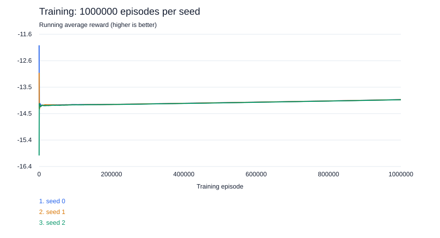

# Tabular Q-learning on 4×4

## Training configurations and evaluation results

Four independently trained budgets are compared below, using seeds **0, 1, 2**.
Each seed is evaluated on the same **40 held-out layouts** (184 training / 40
validation / 40 test layouts). That is 120 test games per experiment, but only 40
unique test layouts. Models are selected by validation score, not test score.

**Table 1. Training configurations and evaluation results.**

| Metric | Exp. 1 | Exp. 2 | Exp. 3 | Exp. 4 |
|---|---:|---:|---:|---:|
| Training episodes per seed | 1,000 | 10,000 | 100,000 | 1,000,000 |
| Training seeds | 0, 1, 2 | 0, 1, 2 | 0, 1, 2 | 0, 1, 2 |
| Learning rate (alpha) | 0.1 | 0.1 | 0.1 | 0.1 |
| Discount factor (gamma) | 1.0 | 1.0 | 1.0 | 1.0 |
| Epsilon schedule | Linear: 1.0 to 0.05 | Linear: 1.0 to 0.05 | Linear: 1.0 to 0.05 | Linear: 1.0 to 0.05 |
| Validation interval (episodes) | 100 | 1,000 | 10,000 | 100,000 |
| Selected checkpoint episodes (seeds 0 / 1 / 2) | 600 / 700 / 900 | 2,000 / 5,000 / 8,000 | 70,000 / 30,000 / 20,000 | 600,000 / 700,000 / 700,000 |
| Evaluation episodes per seed | 40 | 40 | 40 | 40 |
| Unique states in saved Q-table (mean) | 8,456.3 | 51,312.7 | 333,220.3 | 2,858,623.0 |
| Average evaluation reward | -14.2417 | -13.8917 | -14.0000 | -13.8667 |
| Average episode length (shots) | 14.2417 | 13.8917 | 14.0000 | 13.8667 |
| Std across seed mean episode lengths | 0.3631 | 0.0236 | 0.4188 | 0.2435 |
| Total evaluation user CPU time (s; all 3 seeds) | 0.046875 | 0.046875 | 0.046875 | 0.031250 |
| Unique unseen evaluation states (mean) | 441.0 | 393.3 | 343.3 | 225.3 |
| Actions using Q-table (%) | 21.51 | 28.98 | 37.96 | 59.33 |
| Random actions for unseen states (%) | 78.49 | 71.02 | 62.04 | 40.67 |
| Training time per seed (s; mean) | 0.684 | 4.589 | 37.669 | 379.146 |

Except for the explicitly labeled CPU-time total and checkpoint lists, evaluation
metrics are arithmetic means over the three training seeds. State counts are
means per model, not the union of states across models. Percentages are the mean
of each seed's action percentage. The standard deviation is the population
standard deviation of the three seed-level mean episode lengths, not game-level
variation. CPU values have coarse timer resolution; a recorded zero does not mean
no computation occurred.

The implementation uses **linear epsilon decay**, not an exponential decay rate.
Each budget reaches epsilon 0.05 at its final episode. Consequently these compare
complete budget-specific training schedules, not checkpoints from one continued
run. Each budget has ten scheduled validation intervals plus episode-zero validation.
Unique Q-table state counts refer to the **selected checkpoint**, which can precede
the end of training; training times cover the full requested run, excluding
validation and serialization.

Sources: [1,000 episodes](results/experiment_1k/test_results.json),
[10,000 episodes](results/experiment_10k/test_results.json),
[100,000 episodes](results/experiment_100k/test_results.json),
[1,000,000 episodes](results/experiment_1m/test_results.json).
Each experiment folder also contains its exact configuration and per-seed data.

### Final experiment: 1,000,000-episode training reward

Repository contents include summary metrics, per-test-game results, validation
histories and SVG figures. Full per-episode reward CSVs and model checkpoints are
retained locally and excluded from Git; the reproduction commands below regenerate
them. References to reward CSVs in experiment reports describe local exports.



**Figure 1.** Cumulative mean of actual training rewards after each episode:
`running_average_reward(n) = sum(reward[1:n]) / n`. Each shot has reward -1,
so higher (less negative) values mean fewer shots. This is a **training** curve
with exploration, not the held-out evaluation reward. Each line corresponds to
one independent seed; it is not an average over the three seeds. The SVG samples
about 2,000 plotted points per seed; the saved CSVs retain all 1,000,000 episodes.

Final cumulative training rewards:

| Seed | Running average reward at episode 1,000,000 |
|---|---:|
| 0 | -13.972839 |
| 1 | -13.973318 |
| 2 | -13.976796 |

Mean of the three final cumulative training rewards: **-13.974318**.

The evaluation mean is not monotonic with training budget: **14.2417, 13.8917,
14.0000, 13.8667 shots**. The 1,000,000-episode models improve Q-table coverage
(mean lookup usage **59.33%**), but remain close to the random baseline (**14.1000**
shots) and behind probability density (**8.6250** shots) on this split. This is a
descriptive result, not evidence of a statistically significant improvement.

## Folder layout and commands

All Q-learning-specific code is collected here. The shared Battleship environment,
baseline agents and runner remain in their existing modules and are imported.

```text
battleship/q_learning/
  __init__.py       # exports QLearningAgent
  __main__.py       # thin command entry for python -m battleship.q_learning
  Q_learning.py     # agent, training, evaluation, progress, plotting and exports
  tests/
    __init__.py
    test_agent.py   # unit and integration tests
  README.md
  artifacts/        # internal training files; ignored by Git
  results/          # created only by evaluation; ready to commit to GitHub
```

The four completed experiments and their reproduction commands are listed below.
Run commands from the project root. There is no need to retrain to view the saved
results. To repeat an experiment, choose new training and result directory names
so existing artifacts are preserved.

Training displays a progress bar per seed: percentage, completed/total episodes,
elapsed time, estimated remaining time and episodes/second. It does not run final
testing or export publication results. The bar uses the standard library and
requires no tqdm installation.
It retains models, configuration and validation history locally, because later
testing needs these to report learning curves, checkpoint choice and training time.
Validation still runs internally to select the best checkpoint.

Evaluation loads all training seeds by default, tests only the saved held-out
layouts, compares baselines, and exports the report once everything finishes.
The terminal prints a compact statistics block per seed, like the reference
Q_learning.py: user CPU time, unique Q-table states, mean evaluation reward,
mean episode length, unique unseen states, Q-table action percentage and unseen-state
random-action percentage. Episode counts reflect the real test split (40 by default),
not the reference example's 10,000 episodes.
Use `--seeds 0` to evaluate one training seed. A different training folder can be
passed as the positional argument. For compatibility, a `seed_N.json.gz` path also
selects one model, but its adjacent config and curve files are required. The old
`--games` option is removed: this report always uses the recorded test split.
The project-wide pytest configuration also discovers this folder's tests.

The output folder must be empty or new. For a repeat run, use a suffix such as
`experiment_1k_repeat`. Files exported only at testing time:

- `README.md`: experiment settings, results table, descriptive comparison and limitations.
- `config.json`: parameters, seeds, explicit splits, source hashes, Git revision/dirty state,
  Python/platform and timestamps for training and evaluation.
- `test_results.json`: per-model and baseline metrics, model hashes, selected episodes,
  and aggregate variation across training seeds (null when only one seed is tested).
- `comparison.csv`: metrics as a flat table.
- `test_games.csv`: shot counts and decision time per layout, including policy seeds.
- `seed_N_curve.csv`: the saved validation learning curves.
- `seed_N_rewards.csv`: actual reward and cumulative average reward for every training episode.
- `summary.txt`: the compact statistics printed in the terminal.
- `learning_curve.svg`: the only figure, showing cumulative average training reward
  versus training episode, with one line per seed. Reward is minus the number of shots;
  higher (less negative) is better. The README places this figure above the statistics.
  No action-distribution heatmap or comparison figure is generated. SVG avoids extra
  plotting dependencies; open the generated README preview to view the figure.

All four completed experiments contain per-episode reward histories. Their saved
curves and reports can be viewed directly; no retraining is required.

Checkpoint selection and greedy evaluation policy are unchanged; the reference's
softmax policy and learning-rate schedule were not adopted. Known-state Q-table
usage includes ties and does not imply that every available action was learned.

Commit the four `results/experiment_1k/`, `experiment_10k/`, `experiment_100k/`
and `experiment_1m/` directories, together with this README, to GitHub. Model files are
not copied into the report; they stay in ignored `artifacts/` and can be published
separately. No training or testing was executed while implementing these changes.

## Scope and interface

`battleship/q_learning/Q_learning.py` provides `QLearningAgent`, implementing the
existing `Agent` interface. It accepts MINI only: a 4×4 board, ships of lengths
3 and 2, and revealed sunk cells. Other configurations fail explicitly.
It plugs into `play_solo`, `train`, `evaluate`, and MINI tournaments.

The state key encodes all 16 publicly observed cells (unknown, miss, hit, sunk),
followed by the remaining ship lengths. It never uses hidden placements or the
layout revealed in `end_game`. This is a tabular public-observation encoding,
not a full POMDP belief or an encoding of the ordered feedback history.

## Learning rule

Each shot receives the environment's reward of -1:

    Q(s, a) <- Q(s, a) + alpha * (target - Q(s, a))
    target = -1                                      if terminal
    target = -1 + gamma * max legal a' Q(s', a')      otherwise

Only visited state/action pairs are stored. Missing entries have value zero,
which is optimistic for negative shot costs. Invalid actions are excluded from
both action selection and the next-state maximum. Terminal transitions never
bootstrap, even if unshot cells remain.

Defaults: alpha=0.1, gamma=1.0, epsilon=0.1. With gamma=1, maximizing return
minimizes total shots. Other gamma values are supported for experiments but
change the objective. Ties are broken uniformly with the runner-provided RNG.

Exploration and Q updates occur only with `training=True`. Evaluation performs
greedy selection, including random tie breaking, without adding Q-table entries.
Loaded models start in evaluation mode. `save`/`load` use versioned gzip JSON.

## Reproducing the four experiments

These commands describe the completed runs. Use new output directory names when
repeating them; the existing result directories are already populated.

### 1,000 episodes per seed

```powershell
python -m battleship.q_learning train --episodes 1000 --seeds 0 1 2 --eval-every 100 --output battleship/q_learning/artifacts/run_1k
python -m battleship.q_learning test battleship/q_learning/artifacts/run_1k --output battleship/q_learning/results/experiment_1k
```

### 10,000 episodes per seed

```powershell
python -m battleship.q_learning train --episodes 10000 --seeds 0 1 2 --eval-every 1000 --output battleship/q_learning/artifacts/run_10k
python -m battleship.q_learning test battleship/q_learning/artifacts/run_10k --output battleship/q_learning/results/experiment_10k
```

### 100,000 episodes per seed

```powershell
python -m battleship.q_learning train --episodes 100000 --seeds 0 1 2 --eval-every 10000 --output battleship/q_learning/artifacts/run_100k
python -m battleship.q_learning test battleship/q_learning/artifacts/run_100k --output battleship/q_learning/results/experiment_100k
```

### 1,000,000 episodes per seed

```powershell
python -m battleship.q_learning train --episodes 1000000 --seeds 0 1 2 --eval-every 100000 --output battleship/q_learning/artifacts/run_1m
python -m battleship.q_learning test battleship/q_learning/artifacts/run_1m --output battleship/q_learning/results/experiment_1m
```

The script shuffles all 264 layouts with split seed 42, then uses 184 training,
40 validation and 40 test layouts. These sets are disjoint by actual placement,
not merely by random seed. All training seeds use the same split. Training
samples only from the training layouts, with independent seeded policy RNGs.

Epsilon decays linearly from 1.0 to 0.05 across the requested episodes. Validation
runs before training, at the configured `--eval-every` interval, and at the final
episode. The four experiments use intervals of 100 / 1,000 / 10,000 / 100,000
episodes respectively; 2,000 is only the CLI default. The checkpoint
with the lowest validation mean is retained; ties retain the earlier checkpoint.
The initial untrained model is eligible, so training is not assumed to improve it.
The separate evaluation command uses that selected checkpoint. Baselines face the
same held-out layouts and policy seeds as the learned agents.

CLI options allow changing alpha, gamma, epsilon endpoints, episode count,
evaluation interval, training seeds, split seed, and output directory. Defaults
are starting values, not validated hyperparameters. For parameter comparisons,
use separate output directories and select settings using validation curves;
do not select settings from test scores.

Saved under `battleship/q_learning/artifacts/` (ignored by Git):

- `config.json`: parameters and explicit split layouts.
- `seed_N.json.gz`: best validation checkpoint.
- `seed_N_final.json.gz`: final training checkpoint.
- `seed_N_curve.csv`: validation mean/std, epsilon, state count, training shots
  and cumulative training time (excluding validation and serialization).
- `seed_N_rewards.csv`: per-episode reward and cumulative mean for the final plot.

Reusing an output directory overwrites files for matching seeds. Checkpoints
support inference/loading but do not contain RNG/schedule state for exact resume.

## Existing evaluation integration

```bash
uv run scripts/evaluate_all.py --q-table battleship/q_learning/artifacts/run_1m/seed_0.json.gz
uv run scripts/evaluate_all.py --q-table battleship/q_learning/artifacts/run_1m/seed_0.json.gz --tournament 200
```

These commands use MINI by default and reject `--board classic` with a Q-table.
The existing evaluator defaults to all layouts, including training layouts;
those metrics are not held-out generalization scores. Use the Q-learning evaluation
module above for the disjoint-layout comparison and exported report.

## Verification status and limitations

Tests have been added for Bellman updates, masking illegal next actions, terminal
updates, exploration, frozen evaluation, state encoding, reproducibility,
serialization, legal completion over all layouts, and disjoint dataset splits.
The automated tests have not been run by the coding assistant. The four user-run
training/evaluation experiments are recorded above; this documentation update only
reads their saved results and does not rerun training or evaluation. Full-board tabular states may be sparse even on 4×4, and unseen states fall
back to random ties; beating the heuristic or POMDP baselines is not guaranteed.
The evaluation command exports the reward plot from actual per-episode records. Hyperparameter
search is not automated in this implementation.
