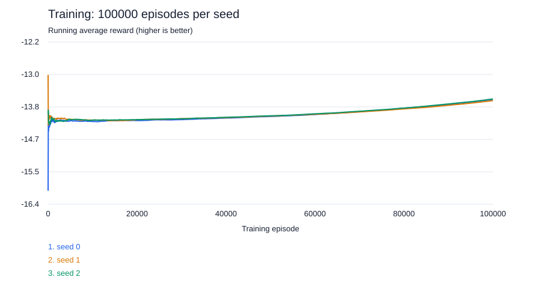

# 4x4 Q-learning experiment



```text
Q-learning seed 0 (selected episode: 100000)
Total user CPU time for 264 evaluation episodes (seconds): 0.0469
Number of unique states: 427615
Average reward over 264 evaluation episodes: -11.9432
Average episode length: 11.9432
Number of unique unseen states: 0
Actions with a learned value: 100.00%
Untried actions in seen states (default value): 0.00%
Actions in unseen states (lowest legal cell): 0.00%

Q-learning seed 1 (selected episode: 100000)
Total user CPU time for 264 evaluation episodes (seconds): 0.0938
Number of unique states: 427113
Average reward over 264 evaluation episodes: -11.9659
Average episode length: 11.9659
Number of unique unseen states: 0
Actions with a learned value: 100.00%
Untried actions in seen states (default value): 0.00%
Actions in unseen states (lowest legal cell): 0.00%

Q-learning seed 2 (selected episode: 100000)
Total user CPU time for 264 evaluation episodes (seconds): 0.0625
Number of unique states: 428204
Average reward over 264 evaluation episodes: -11.7841
Average episode length: 11.7841
Number of unique unseen states: 1
Actions with a learned value: 99.97%
Untried actions in seen states (default value): 0.00%
Actions in unseen states (lowest legal cell): 0.03%
```

The curve is the cumulative mean of actual training episode rewards (reward = -shots), not validation performance. Each seed has its own line.
Decisions are split three ways: the chosen action had a learned value; the state was seen but the chosen action was never tried (it ranked first at the default value); or the state was never seen, so every action tied at the default and the lowest-numbered legal cell was fired. No evaluation exploration is enabled.
Statistics describe the final model, while curves cover the entire training run. CPU time measures evaluation user CPU time only.

## Setup

- Board: 4x4; fleet: 3 and 2; sunk cells revealed; reward: -1 per shot.
- Training episodes per seed: 100000; evaluated seeds: [0, 1, 2].
- Alpha: 1/N(s, a); gamma: 1.0; epsilon: 1.0 -> 0.05 (linear).
- Layouts: training draws uniformly from all 264 layouts (the game's distribution); testing plays every one of the 264 once, as for every other agent. This is not a generalization test: a Q-table cannot play layouts it never saw.
- Model: the final one; no checkpoint is selected (the curve's evaluations are only recorded).
- Test: one game per layout; policy RNG seed = layout index, shared across agents.
- Exploration and learning disabled during testing.
- Training commit: 49d0e03dd0c3a1ce6e36fa7698f84ab033f42413; dirty: False.
- Evaluation commit: 49d0e03dd0c3a1ce6e36fa7698f84ab033f42413; dirty: False.
- Exact layouts, runtime/source hashes and parameters: [config.json](config.json). Model hashes: [test_results.json](test_results.json).

## Test results

| Agent | Seed | Games | Mean shots | Game std | Median | Worst | Training s | Decision ms | Selected episode |
|---|---:|---:|---:|---:|---:|---:|---:|---:|---:|
| q-learning | 0 | 264 | 11.943 | 2.293 | 12.0 | 16 | 34.27 | 0.0108 | 100000 |
| q-learning | 1 | 264 | 11.966 | 2.367 | 12.0 | 16 | 29.02 | 0.0107 | 100000 |
| q-learning | 2 | 264 | 11.784 | 2.282 | 12.0 | 16 | 29.72 | 0.0107 | 100000 |
| random | - | 264 | 14.227 | 1.824 | 15.0 | 16 | N/A | 0.0025 | - |
| hunt-target | - | 264 | 10.201 | 2.529 | 10.0 | 16 | N/A | 0.0043 | - |
| hunt-target+parity | - | 264 | 9.697 | 2.130 | 10.0 | 14 | N/A | 0.0056 | - |
| probability-density | - | 264 | 8.864 | 1.566 | 9.0 | 12 | N/A | 0.0157 | - |

## Across training seeds

Mean of Q-learning test means: **11.898** shots.
Population standard deviation across those means: **0.081** shots.
This is distinct from Game std above, which measures variation between layouts within one run.

## Observed comparison and limitations

Q-learning's mean across training seeds minus the best listed baseline (probability-density): **+3.034** shots. Negative means fewer shots; positive means more.
This is a descriptive comparison on these test layouts, not a significance claim. Do not tune hyperparameters using these test scores.
Training time includes training games only; validation and serialization are excluded. Decision time is measured on the evaluation machine.
Full-board Q-tables may have sparse coverage; in an unseen state the lowest-numbered legal cell is fired.

The single SVG figure is viewable on GitHub. Plot rendering is sampled to about 2,000 points per seed; the full per-episode reward CSVs are written next to this report but are not committed to Git (see .gitignore). No second figure is generated.

## Reproduction

Use the recorded source revision and parameters in config.json. Run training, then the separate evaluation command documented in ../../README.md. Models remain in the training artifacts directory; publish them separately if needed, matching the SHA-256 hashes recorded here.
