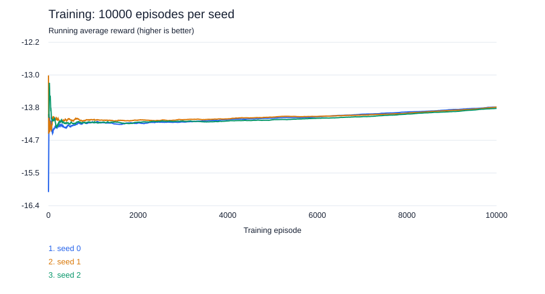

# 4x4 Q-learning experiment



```text
Q-learning seed 0 (selected episode: 2000)
Total user CPU time for 40 evaluation episodes (seconds): 0.0156
Number of unique states: 21819
Average reward over 40 evaluation episodes: -13.9250
Average episode length: 13.9250
Number of unique unseen states: 411
Actions using Q-table: 25.67%
Random actions due to unseen states: 74.33%

Q-learning seed 1 (selected episode: 5000)
Total user CPU time for 40 evaluation episodes (seconds): 0.0156
Number of unique states: 52011
Average reward over 40 evaluation episodes: -13.8750
Average episode length: 13.8750
Number of unique unseen states: 391
Actions using Q-table: 29.37%
Random actions due to unseen states: 70.63%

Q-learning seed 2 (selected episode: 8000)
Total user CPU time for 40 evaluation episodes (seconds): 0.0156
Number of unique states: 80108
Average reward over 40 evaluation episodes: -13.8750
Average episode length: 13.8750
Number of unique unseen states: 378
Actions using Q-table: 31.89%
Random actions due to unseen states: 68.11%
```

The curve is the cumulative mean of actual training episode rewards (reward = -shots), not validation performance. Each seed has its own line.
Q-table usage counts lookups of known states, including tied or partially populated action rows; it does not guarantee an informed action. Unseen states use the existing random tie fallback. No evaluation exploration is enabled.
Statistics describe the validation-selected checkpoint, while curves cover the entire training run. CPU time measures evaluation user CPU time only.

## Setup

- Board: 4x4; fleet: 3 and 2; sunk cells revealed; reward: -1 per shot.
- Training episodes per seed: 10000; evaluated seeds: [0, 1, 2].
- Alpha: 0.1; gamma: 1.0; epsilon: 1.0 -> 0.05 (linear).
- Layout counts: train=184, validation=40, test=40.
- Checkpoint: lowest validation mean; ties keep the earliest checkpoint, including episode 0.
- Test: one game per held-out layout; policy RNG seed = layout index, shared across agents.
- Exploration and learning disabled during testing.
- Training commit: 5d7b2a9164c074440d8b0525b6eed2b834431c85; dirty: True.
- Evaluation commit: 5d7b2a9164c074440d8b0525b6eed2b834431c85; dirty: True.
- Exact layouts, runtime/source hashes and parameters: [config.json](config.json). Model hashes: [test_results.json](test_results.json).

## Test results

| Agent | Seed | Games | Mean shots | Game std | Median | Worst | Training s | Decision ms | Selected episode |
|---|---:|---:|---:|---:|---:|---:|---:|---:|---:|
| q-learning | 0 | 40 | 13.925 | 1.992 | 14.5 | 16 | 5.23 | 0.0149 | 2000 |
| q-learning | 1 | 40 | 13.875 | 2.315 | 14.5 | 16 | 4.51 | 0.0170 | 5000 |
| q-learning | 2 | 40 | 13.875 | 1.735 | 14.0 | 16 | 4.03 | 0.0164 | 8000 |
| random | - | 40 | 14.100 | 2.059 | 15.0 | 16 | N/A | 0.0033 | - |
| hunt-target | - | 40 | 10.775 | 2.688 | 10.0 | 16 | N/A | 0.0056 | - |
| hunt-target+parity | - | 40 | 9.450 | 1.870 | 10.0 | 15 | N/A | 0.0075 | - |
| probability-density | - | 40 | 8.625 | 1.576 | 9.0 | 12 | N/A | 0.0222 | - |

## Across training seeds

Mean of Q-learning test means: **13.892** shots.
Population standard deviation across those means: **0.024** shots.
This is distinct from Game std above, which measures variation between layouts within one run.

## Observed comparison and limitations

Q-learning's mean across training seeds minus the best listed baseline (probability-density): **+5.267** shots. Negative means fewer shots; positive means more.
This is a descriptive comparison on this fixed test split, not a significance claim. Do not tune hyperparameters using these test scores.
Training time includes training games only; validation and serialization are excluded. Decision time is measured on the evaluation machine.
Full-board Q-tables may have sparse coverage; unseen states choose randomly among tied legal actions. Episode-0 checkpoints can be selected if training did not improve validation performance.

The single SVG figure is viewable on GitHub. Plot rendering is sampled to about 2,000 points per seed; reward CSVs retain every episode. No second figure is generated.

## Reproduction

Use the recorded source revision and parameters in config.json. Run training, then the separate evaluation command documented in ../../README.md. Models remain in the training artifacts directory; publish them separately if needed, matching the SHA-256 hashes recorded here.
