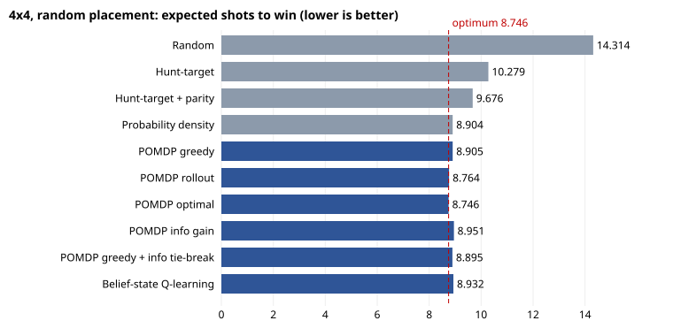

# Comparing the 4×4 agents (issue #5)

`scripts/compare_4x4.py` puts every 4×4 agent on the same footing:

- **Same games.** Every agent plays every one of the 264 layouts, three times
  (agent seeds 0–2, which only change tie-breaking). No sampled or held-out test
  set, so the random-placement numbers are exact up to tie-breaking. As a check,
  the optimal planner's games average exactly the Bellman value, 8.746.
- **Opponents with habits.** The same games are re-weighted by each habit in
  `battleship/opponents.py`, which gives the exact expected shots against that
  opponent. The opponent-belief oracle (a POMDP agent told the habit) is the best case.
- **Head-to-head.** Every pair plays 400 full games, alternating who shoots first.

Results (`results/compare_4x4/`) include the information-gain planners (issue
#12) and belief-state Q-learning (PR #15, seed 0 after 1,000,000 episodes).
Raw-board Q-learning (#14/#18) and DQN (#17/#20) can be added to
`build_agents` once merged.

## Random placement

| Agent | Mean shots | Std | Worst | Gap to optimum |
|---|---:|---:|---:|---:|
| POMDP optimal | 8.746 | 1.61 | 12 | +0.000 |
| POMDP rollout | 8.764 | 1.61 | 12 | +0.018 |
| POMDP greedy + info tie-break | 8.895 | 1.60 | 12 | +0.149 |
| Probability density | 8.904 | 1.60 | 12 | +0.158 |
| POMDP greedy | 8.905 | 1.61 | 12 | +0.159 |
| Belief-state Q-learning | 8.932 | 1.71 | 13 | +0.186 |
| POMDP info gain | 8.951 | 1.75 | 14 | +0.205 |
| Hunt-target + parity | 9.676 | 1.97 | 14 | +0.929 |
| Hunt-target | 10.279 | 2.48 | 16 | +1.533 |
| Random | 14.314 | 1.91 | 16 | +5.568 |

## Against opponents with placement habits

| Agent | uniform | edges | center | horizontal | touching | 3 favorites |
|---|---:|---:|---:|---:|---:|---:|
| Random | 14.314 | 14.316 | 14.235 | 14.284 | 14.331 | 14.444 |
| Hunt-target + parity | 9.676 | 9.773 | 9.578 | 9.644 | 9.339 | 8.667 |
| Probability density | 8.904 | 9.487 | 8.110 | 8.865 | 8.621 | 8.333 |
| POMDP greedy | 8.905 | 9.532 | 8.093 | 8.874 | 8.617 | 7.889 |
| POMDP optimal | 8.746 | 9.336 | 7.861 | 8.737 | 8.386 | 8.222 |
| Belief-state Q-learning | 8.932 | 9.493 | 8.106 | 8.901 | 8.532 | 11.000 |
| POMDP greedy, told the habit (oracle) | 8.905 | **8.297** | **7.811** | **8.378** | **8.142** | **5.667** |

Full table, including every agent, in `results/compare_4x4/results.md`.

## What the comparison shows

1. **The POMDP planners lead, and the gaps are small at the top.** Rollout gets
   within 0.02 shots of the optimum; greedy, probability density and belief-state
   Q-learning are all within 0.2. Hunt-target is a full shot or more behind.
2. **Learning from rewards nearly matches planning.** Belief-state Q-learning
   (8.932) is 0.03 shots behind POMDP greedy, without being given the planner.
3. **Information alone is the wrong goal.** Pure information gain is the weakest
   POMDP planner; used only to break ties it is the best greedy variant.
4. **Optimal for random placement is not optimal against a habit.** Against the
   edge-loving opponent every agent that assumes random placement loses about
   0.6 shots; the oracle, which knows the habit, gains 0.6 instead. Knowing the
   opponent is worth more than a better planner, which motivates the opponent-belief work.
5. **Head-to-head follows the averages but compresses them.** The optimal planner
   has the best overall win rate (0.62), but between the top agents most matches
   are close to 50/50: a 0.1-shot difference in averages rarely decides one game.
   The first player won 56% of games.

## Caveats

- "3 favorites" has only three layouts, so one bad board moves the average a lot
  (belief-state Q-learning's 11.0 is an example); treat that column with care.
- Belief-state Q-learning is one seed; its three-seed mean is 8.972
  (`docs/design_belief_q_learning.md`).
- All agents except the oracle assume random placement and do not learn during
  evaluation.

Reproduce: `uv run scripts/compare_4x4.py --belief-q results/belief_q/seed_0.json.gz`
(about 1 minute; leave out `--belief-q` if PR #15 is not merged).
