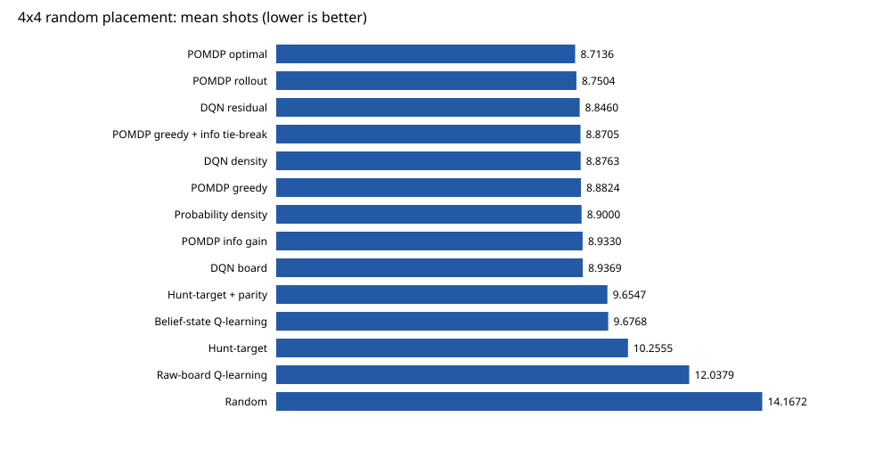
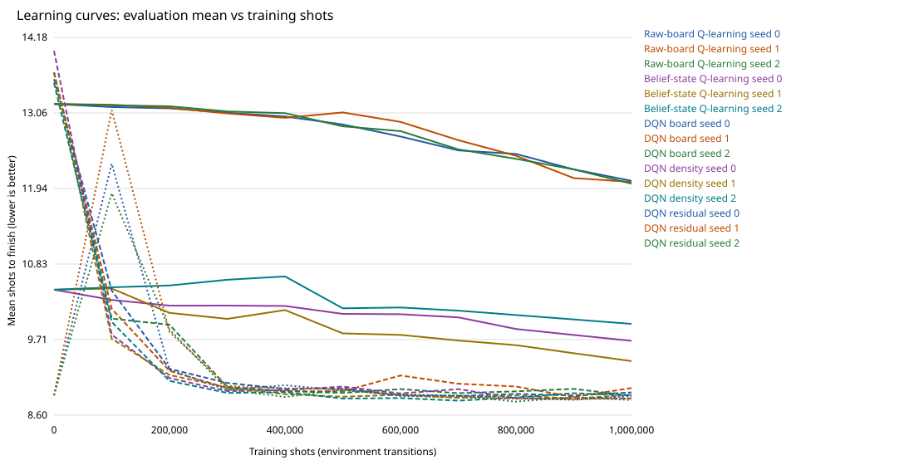

# 4x4 Battleship: agent comparison

**Completed experiment: 14 algorithms, 15 trained models, 126,720 solo evaluation
games and 80,400 head-to-head matches.** Training and recovered-comparison
manifests both report `complete`; coverage, checkpoint hashes and tournament
counts/matrix were checked. The audit is in
[validation.json](../results/compare_4x4_recovered/validation.json).

POMDP optimal and rollout lead the measured shot-count and tournament results.
Among learning methods, DQN residual has the lowest observed mean, 8.8460 shots,
followed by DQN density at 8.8763 and DQN board at 8.9369. These small gaps are
descriptive results of three training seeds, not claims of statistical significance.

## Task and experimental protocol

- Board: 4x4, ship lengths 3 and 2, straight ships, touching allowed, no overlap,
  sunk cells revealed; reward is -1 per shot.
- Learning methods: raw-board Q-learning, belief-state Q-learning, DQN board,
  DQN density input and DQN density residual. Each uses training seeds 0, 1 and 2
  with exactly 1,000,000 new environment transitions per seed: 15 trained models.
- Nine seedless baselines/planners: random, hunt-target, hunt-target + parity,
  probability density, and POMDP greedy, rollout, optimal, information gain,
  greedy with information-gain tie-breaking.
- Training budget is **shots, not episodes**. Shots in a final unfinished game
  count; replay samples are not new interactions. Final checkpoints are used,
  without selecting a best checkpoint by evaluation score.
- Exploration decays linearly from 1.0 to .05 over the interaction budget;
  DQN updates exploration once per vector batch. Models are trained sequentially.
- Final solo evaluation covers all 264 layouts and 20 policy RNG seeds per layout:
  5,280 games per model/policy entry, 24 entries and 126,720 games in total.
  Effective policy seed is `layout_index * 1000003 + policy_seed`.
- Learning is disabled during evaluation. Algorithm means weight training seeds
  equally. Layouts belong to the same finite training/evaluation distribution;
  this is not held-out-layout generalization.
- DQN training used CPU, 256 parallel environments, one PyTorch CPU thread, and
  30,938 gradient updates per model. Exact hyperparameters, versions and device
  are retained in [training_metadata](../results/compare_4x4_recovered/training_metadata/).

## Uniform-placement performance and cost

| Agent | Mean shots | Game std | Seed std | Observed worst | Train s/seed | Decision ms |
|---|---|---|---|---|---|---|
| POMDP optimal | 8.7136 | 1.6113 | N/A | 12 | N/A | 0.0988 |
| POMDP rollout | 8.7504 | 1.6091 | N/A | 12 | N/A | 0.2289 |
| DQN residual | 8.8460 | 1.6218 | 0.0250 | 13 | 1181.57 | 1.5259 |
| POMDP greedy + info tie-break | 8.8705 | 1.6061 | N/A | 13 | N/A | 0.1068 |
| DQN density | 8.8763 | 1.6445 | 0.0228 | 12 | 1298.87 | 1.3339 |
| POMDP greedy | 8.8824 | 1.6128 | N/A | 13 | N/A | 0.2198 |
| Probability density | 8.9000 | 1.6111 | N/A | 13 | N/A | 0.0600 |
| POMDP info gain | 8.9330 | 1.7544 | N/A | 14 | N/A | 0.0978 |
| DQN board | 8.9369 | 1.6579 | 0.0465 | 13 | 741.50 | 0.6907 |
| Hunt-target + parity | 9.6547 | 2.0207 | N/A | 16 | N/A | 0.0164 |
| Belief-state Q-learning | 9.6768 | 1.8887 | 0.2245 | 14 | 13.37 | 0.0530 |
| Hunt-target | 10.2555 | 2.5777 | N/A | 16 | N/A | 0.0099 |
| Raw-board Q-learning | 12.0379 | 2.4045 | 0.0172 | 16 | 28.14 | 0.0192 |
| Random | 14.1672 | 1.8886 | N/A | 16 | N/A | 0.0070 |



Lower mean shots is better. Game standard deviation includes layout, random-choice
and trained-model variation; seed standard deviation measures variation between
training-seed means. N/A denotes an untrained baseline. Neither spread is a
confidence interval. The observed worst is a finite-run maximum, not a proof.

The **exact Bellman optimum is 8.746212 shots**, while the sampled optimal-policy
mean is 8.713636. Randomized policies were sampled rather than integrated over all
tie choices, so finite-sample averages can be below the exact expectation. This
is not evidence of beating the optimum. Negative sampled gaps must be interpreted
in that light; 20 RNG seeds per layout do not provide an exact policy expectation.

Raw-board Q-learning improves over random, 12.0379 versus 14.1672, but is behind
both belief Q-learning (9.6768) and the DQNs. Belief Q-learning is near hunt-target
with parity in this run and has the largest training-seed spread among learners
(0.2245). The experiment does not establish a stable ordering between those two.
The current one-million-shot budget is substantially smaller than earlier GitHub
experiments using one million completed episodes; their scores are not directly
comparable to this run.

DQN residual's observed advantage over probability density is 0.0540 shots; density
DQN's is 0.0237. Their single-decision CPU costs are about 1.53 and 1.33 ms versus
0.060 ms for probability density. Board DQN takes about 0.69 ms per decision.
DQN training averages roughly 12.4 to 21.6 minutes per seed; raw and belief Q-learning
average 28.14 and 13.37 seconds. Faster training does not imply better playing skill.

Decision timing covers `select_shot`, including deferred belief updates, and
excludes `observe`, resets, model loading and one warm-up game. Planner caches can
already be warm. Training time excludes evaluation and checkpoint writing; tabular
time sums training transitions including resets, while DQN includes loop/replay/
optimizer work but excludes initial network/buffer setup. Wall times including
setup/evaluation/save are retained separately. These timing boundaries and machine
conditions limit direct computational-cost comparisons.

## Learning curves and sample efficiency

Mean curve-point evaluation scores across the three training seeds:

| Method | 0 shots | 100k shots | 500k shots | 1M shots |
|---|---|---|---|---|
| Raw-board Q-learning | 13.1932 | 13.1679 | 12.9407 | 12.0379 |
| Belief-state Q-learning | 10.4495 | 10.4162 | 10.0236 | 9.6768 |
| DQN board | 13.6250 | 10.2083 | 8.9545 | 8.9369 |
| DQN density | 13.7146 | 9.8270 | 8.9091 | 8.8763 |
| DQN residual | 8.8902 | 12.4293 | 8.9735 | 8.8460 |



Tabular curve points use three policy samples per layout; final evaluation uses
20. DQNs choose actions deterministically. Curve values are evaluation performance,
not training reward. The numerical source is
[learning_curve_summary.csv](../results/compare_4x4_recovered/learning_curve_summary.csv).

Both Q-tables continue improving late in the budget: raw Q-learning falls from
12.1843 at 900k shots to 12.0379 at 1M; belief Q-learning falls from 9.7668 to 9.6768.
There is no evidence here that either has converged. DQN board and density reach
roughly nine-shot performance by 500k shots and fluctuate thereafter.

Residual DQN starts from a strong density-based policy (8.8902), worsens to 12.4293
at 100k shots, then recovers to 8.8460. Its final improvement over its own initial
score is only about 0.0442 shots in this run. Its strong final score therefore
cannot be attributed entirely to learning: the handcrafted baseline supplies much
of the initial performance. Later DQN curve points are not monotonically better;
all reported models remain the final checkpoints.

## Opponents with placement habits

Each learning-method row below averages its three trained seeds. Other rows are
single policies. The oracle is told the distribution in advance; it is not trained
to infer the opponent's habit.

| Agent | uniform | edges | center | horizontal | touching | 3 favorites |
|---|---|---|---|---|---|---|
| Random | 14.1672 | 14.2055 | 14.1240 | 14.2111 | 14.1530 | 14.2500 |
| Hunt-target | 10.2555 | 10.2694 | 10.1880 | 10.2815 | 9.9515 | 9.5167 |
| Hunt-target + parity | 9.6547 | 9.5989 | 9.7122 | 9.6743 | 9.3923 | 9.1333 |
| Probability density | 8.9000 | 9.4907 | 8.1242 | 8.9621 | 8.6132 | 8.4000 |
| POMDP greedy | 8.8824 | 9.5258 | 8.1039 | 8.9449 | 8.5869 | 8.3000 |
| POMDP rollout | 8.7504 | 9.3434 | 7.8268 | 8.8066 | 8.4018 | 8.3167 |
| POMDP optimal | 8.7136 | 9.2979 | 7.8386 | 8.7498 | 8.3375 | 8.2167 |
| POMDP info gain | 8.9330 | 9.6023 | 8.0717 | 8.9582 | 8.5326 | 8.4000 |
| POMDP greedy + info tie-break | 8.8705 | 9.4858 | 8.1034 | 8.9307 | 8.5686 | 8.3000 |
| Raw-board Q-learning | 12.0379 | 12.0772 | 12.0230 | 12.1855 | 11.8484 | 13.3333 |
| Belief-state Q-learning | 9.6768 | 9.8853 | 9.6206 | 9.6461 | 9.6473 | 9.7778 |
| DQN board | 8.9369 | 9.4216 | 8.3774 | 8.9960 | 8.6262 | 8.4444 |
| DQN density | 8.8763 | 9.4270 | 8.3228 | 8.8940 | 8.5587 | 8.1111 |
| DQN residual | 8.8460 | 9.4809 | 8.1913 | 8.9058 | 8.4548 | 8.7778 |
| POMDP greedy, told the habit (oracle) | 8.8824 | 8.3227 | 7.8017 | 8.3618 | 8.1241 | 5.6833 |

Uniform-prior greedy POMDP needs 9.5258 shots against edge-biased placement; the
oracle needs 8.3227, a reduction of about 1.2031 shots. On the three-favorites
opponent, their means are 8.3000 and 5.6833. This demonstrates the value of a correct
placement prior under these distributions, rather than learned opponent adaptation.
The three-favorites column has only three layouts and should be interpreted cautiously.

Habit weights are exact layout probabilities, but random policy choices are still
sampled. Oracle games only use layouts with positive habit probability. This fixes
the earlier interruption caused by evaluating the three-favorites oracle on
impossible layouts; the original solo measurements were validated and reused.

## Head-to-head tournament

The tournament completed **80,400 matches across 201 model-seed pairings**.
Each pairing has 400 matches and alternating first player. Equal learned-seed IDs
are paired; a seedless baseline plays each trained seed. Macro rates give each
opposing algorithm equal weight, rather than giving additional weight to algorithms
with more model replications.

| Agent | Overall macro win rate |
|---|---|
| POMDP optimal | 61.57% |
| POMDP rollout | 60.90% |
| DQN residual | 60.56% |
| DQN density | 59.80% |
| DQN board | 59.05% |
| POMDP greedy + info tie-break | 58.76% |
| POMDP info gain | 57.75% |
| Probability density | 57.44% |
| POMDP greedy | 57.00% |
| Belief-state Q-learning | 49.11% |
| Hunt-target + parity | 47.79% |
| Hunt-target | 41.92% |
| Raw-board Q-learning | 22.28% |
| Random | 6.07% |

The first player won 44,944 of 80,400 matches (**55.90%**). Optimal POMDP has the
highest observed macro win rate, followed by rollout and residual DQN. Small gaps
at the top do not establish a statistically reliable ranking. Full pairwise rates
and counts are in [tournament.csv](../results/compare_4x4_recovered/tournament.csv)
and [tournament_pairs.csv](../results/compare_4x4_recovered/tournament_pairs.csv).

## Example games

These are selected extremes, not typical-performance estimates. Every solo game
eventually finishes; inefficient play is not a solo loss.

- **Efficient residual DQN, seed 2:** layout 111 has ships at A2/B2/C2 and C3/D3.
  It fires B2, C2, A2, D3, C3: five shots with no misses, sinking ships at shots
  3 and 5. This is the minimum possible shot count for five occupied cells.
- **Inefficient residual DQN, seed 2:** layout 47 has ships at B1/C1/D1 and B3/B4.
  It takes 12 shots: four misses before the first hit at B4, then three more misses.
  The ships sink at shots 8 and 12. Initial search accounts for four of its seven
  misses; not all cost comes from following up a hit.
- **Inefficient raw Q-learning, seed 0:** layout 96 has ships at D1/D2/D3 and B3/C3.
  It finds a hit at shot 3 but takes 16 shots overall, with nine misses after first
  contact. The first ship sinks at shot 11 and the second at 16. The observed
  sequence illustrates costly decisions after a hit; it does not by itself prove
  why the learned values caused them.

All 48 reproduced example traces, their layouts and exact RNG seeds are in
[cases.md](../results/compare_4x4_recovered/cases.md) and
[cases.json](../results/compare_4x4_recovered/cases.json).

## Limitations

- The same finite layout distribution is used for training and evaluation.
- Finite random-choice samples and three training seeds limit ranking claims.
  Reported standard deviations are not confidence intervals or significance tests.
- Equal new-transition budgets do not mean equal computation or information.
  Belief methods use an exact model and exclude certain misses; density DQNs use
  handcrafted features, and replay reuses training transitions.
- Timing depends on software, hardware, memory pressure, warm caches and the
  stated measurement boundaries. Checkpoint size is not resident memory.
- Habit-specific opponent-belief Q-learning and larger-board experiments are
  outside this comparison. The oracle has advance knowledge, not learned adaptation.

## Reproduction and recovery provenance

For a fresh run, use a new/empty output directory:

```powershell
uv sync --extra dqn
uv run --extra dqn scripts/train_comparison_4x4.py --shots 1000000 --every 100000 --seeds 0 1 2 --output results/comparison_training
uv run --extra dqn scripts/compare_4x4.py --trained results/comparison_training --require-complete --samples 20 --games 400 --output results/compare_4x4_complete
```

This completed run recovered the previously finished solo stage after correcting
the zero-probability oracle-layout bug:

```powershell
uv run --extra dqn scripts/compare_4x4.py --trained results/comparison_training --require-complete --reuse-solo results/compare_4x4_complete --output results/compare_4x4_recovered
```

Do not rerun those commands into the existing completed directories. Training
checkpoints and their hashes remain unchanged by the evaluation fix. The recovery
manifest records the original solo provenance as well as the current evaluation
sources; the old interrupted directory remains `running` for audit purposes.
The authoritative completed report is
[results.md](../results/compare_4x4_recovered/results.md), not that interrupted folder.

## Published artifacts

The completed data directory is
[results/compare_4x4_recovered](../results/compare_4x4_recovered/): summary and
per-model CSVs, all paired solo games, habit data, match counts/matrix, SVG figures,
traces, audit, copied training curves/configs and manifests. Large learned checkpoints
are kept locally in `results/comparison_training` and excluded from Git. Their
SHA-256 hashes are preserved for separate sharing and verification.

Upload the integrated source/dependency files together with this README and the
completed artifacts. Do not upload `.venv` or describe historical GitHub tables as
new measurements. Source PR snapshots and the detailed protocol are documented in
[comparison_4x4.md](comparison_4x4.md).
