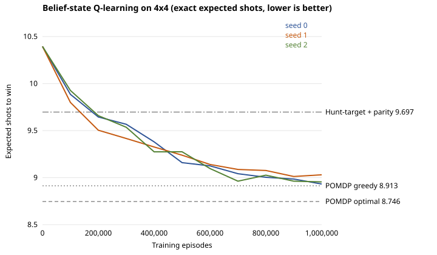

# Belief-state Q-learning (4×4)

Tabular Q-learning whose state is the exact POMDP belief instead of the raw board.
Code: `battleship/agents/belief_q.py` (`BeliefQAgent`), training script
`scripts/train_belief_q.py`, tests `tests/test_belief_q.py`.

## Why the raw-board Q-table stays near random

The raw-board agent (PR #14) keys its table on the 16 visible cells plus the
remaining ships. After 1,000,000 episodes it still meets an unseen state on about
41% of test moves and falls back to a random shot. Three things cause this:

1. **Equivalent boards are separate states.** Many different-looking boards leave
   exactly the same set of possible ship layouts, so they call for the same shot,
   but the table learns each one separately.
2. **Unvisited actions start at 0.** Every reward is −1, so any untried action looks
   better than every tried one, and greedy play keeps choosing untried shots.
3. **Held-out layouts.** With a table and no generalization between states, test
   layouts mostly produce states never seen in training. The hidden layout is part
   of the game's randomness, so training and evaluating on all 264 layouts is fine.

## What this agent changes

| | Raw-board Q-learning | Belief-state Q-learning |
|---|---|---|
| State | visible board + remaining ships | set of consistent layouts + fired hits (`Planner._key`) |
| Actions | every unfired cell | unfired cells some consistent layout covers |
| Unvisited actions | 0 (optimistic) | −20 (pessimistic) |
| Step size | fixed α = 0.1 | 1 / visits(b, a), a running mean of the targets |
| Evaluation | 40 sampled layouts | exact expected shots over all 264 layouts |

The agent never sees the hidden layout: the belief is computed only from public
feedback, exactly as in `BeliefAgent`. The update is ordinary one-step Q-learning
(γ = 1, reward −1 per shot) on the belief MDP of the POMDP. Cells no consistent
layout covers are certain misses; leaving them out removes only dominated actions
and makes the action set depend on the state key alone.

`fast_train` simulates games directly on beliefs with `Planner.outcomes`. A test
checks that these transitions match the environment's. `exact_value` evaluates the
greedy policy exactly with `Planner.policy_value`, so learning curves have no
sampling noise.

## Results

Three seeds, 1,000,000 episodes each, ε decaying linearly from 1.0 to 0.0, exact
evaluation every 100,000 episodes (`results/belief_q/`):

| Episodes | Seed 0 | Seed 1 | Seed 2 |
|---:|---:|---:|---:|
| 0 | 10.395 | 10.395 | 10.395 |
| 200,000 | 9.645 | 9.504 | 9.659 |
| 500,000 | 9.159 | 9.239 | 9.275 |
| 1,000,000 | **8.932** | **9.030** | **8.955** |

Mean after 1,000,000 episodes: **8.972 shots**, with about 320,000 states; the
count levels off, so nearly every reachable belief has been visited. For reference:
hunt-target with parity 9.697, POMDP greedy 8.913, POMDP optimal 8.746. Training
takes about 7 minutes per seed.

## Limitations

- The exact belief is only practical on small boards, so this agent is 4×4 only.
- Results assume ships are placed uniformly at random, like the POMDP optimum.
- The raw-board results were measured on 40 held-out layouts and these exactly on
  all 264, so compare them as trends, not as a precise head-to-head.

Reproduce: `uv run scripts/train_belief_q.py --jobs 3` (seeds 0, 1, 2; 1,000,000 episodes).
