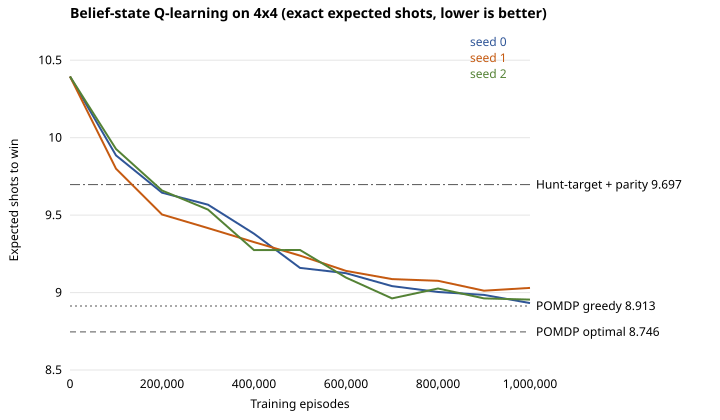

# Belief-state Q-learning (4×4)

Tabular Q-learning whose state is the exact POMDP belief instead of the raw board.
Code: `battleship/agents/belief_q.py` (`BeliefQAgent`), training script
`scripts/train_belief_q.py`, tests `tests/test_belief_q.py`.

## Why the state matters

The raw-board agent (PR #14) keys its table on the 16 visible cells plus the
remaining ships. With sunk cells revealed, that board is a valid Markov state: it
determines exactly which layouts are still possible, so a raw-board table can in
principle learn the same policy. The difference is **sample efficiency**:

- **Many boards share one belief.** Boards that differ only by misses no consistent
  layout could cover leave the same set of possible layouts and call for the same
  shot, but a raw-board table learns each one separately. On 4×4 the belief key
  (`Planner._key`) has **366,307** reachable non-terminal states, while a raw-board
  table holds about **2.2 million** boards after 1,000,000 episodes (about 6 updates
  per board). Both agents make one update per training shot, so with about seven
  times fewer states each belief state is updated far more often.
- **Same budget, same layouts:** with the fixes in PR #18 (pessimistic default,
  1/N step size, fixed tie-breaking, training on all 264 layouts), the raw-board
  agent reaches **10.77** shots after 1,000,000 episodes per seed; this agent reaches
  **8.97**. Both are averaged over seeds 0, 1, 2 and evaluated on all 264 layouts.
  The setups are close but not identical (see the table below), and no ablation
  separates their effects, so the gap is consistent with the state mattering but is
  not attributable to it alone.
- As originally submitted, PR #14 scored about 13.9 shots on 40 held-out layouts,
  close to random (14.1 on the same layouts). It used an optimistic 0.0 default for
  untried actions, a fixed step size α = 0.1 and random tie-breaking, and it was
  tested on layouts it never trained on. PR #18 changes all of these at once, so
  their separate effects are not isolated.

## What this agent changes

| | Raw-board Q-learning (with PR #18) | Belief-state Q-learning |
|---|---|---|
| State | visible board + remaining ships | set of consistent layouts + fired hits (`Planner._key`) |
| Reachable states on 4×4 | millions of boards | 366,307 |
| Actions | every unfired cell | unfired cells some consistent layout covers |
| Unvisited actions | −(number of untried cells) | −20 |
| Step size | 1 / visits(s, a) | 1 / visits(b, a) |
| Greedy ties | lowest-numbered cell | uniformly at random |
| ε schedule | 1.0 → 0.05 | 1.0 → 0.0 |
| Training | through the environment, all 264 layouts | simulated on beliefs, all 264 layouts |
| Evaluation | one game per layout, all 264 | exact expected shots over all 264 |

The two evaluations measure the same quantity: the raw-board greedy policy is
deterministic (ties go to the lowest cell, no exploration), so one game per layout
over all 264 layouts is its exact expected number of shots.

The agent never sees the hidden layout: the belief is computed only from public
feedback, exactly as in `BeliefAgent`. The update is ordinary one-step Q-learning
(γ = 1, reward −1 per shot) on the belief MDP of the POMDP. Cells no consistent
layout covers are certain misses; leaving them out removes only dominated actions
and makes the action set depend on the state key alone.

`fast_train` simulates games directly on beliefs with `Planner.outcomes`. A test
checks that these transitions match the environment's. `exact_value` evaluates the
greedy policy exactly with `Planner.policy_value`, so learning curves have no
sampling noise.

Training samples layouts uniformly from the same 264 layouts the evaluation covers.
On 4×4 that is unavoidable and matches the game's real distribution, but it is not a
held-out generalization test.

## Results

Three seeds, 1,000,000 episodes each, ε decaying linearly from 1.0 to 0.0, exact
evaluation every 100,000 episodes (`results/belief_q/`):

| Episodes | Seed 0 | Seed 1 | Seed 2 |
|---:|---:|---:|---:|
| 0 | 10.395 | 10.395 | 10.395 |
| 200,000 | 9.645 | 9.504 | 9.659 |
| 500,000 | 9.159 | 9.239 | 9.275 |
| 900,000 | 8.985 | 9.012 | 8.962 |
| 1,000,000 | **8.932** | **9.030** | **8.955** |

- **Mean after 1,000,000 episodes: 8.972 shots.** That is close to, but still
  slightly worse than, the non-learning POMDP greedy agent (8.913), and 0.23 shots
  above the optimum (8.746). It beats hunt-target with parity (9.697).
- **Not yet settled.** Between 900,000 and 1,000,000 episodes the seeds still move
  by up to 0.05 shots, in both directions, so 1,000,000 episodes is not a final value.
- **About 320,000 states** after 1,000,000 episodes, 87% of the 366,307 reachable
  ones.
- Training took 459 s (about 7.5 minutes) per seed, with the three seeds run in parallel.

## Limitations

- The exact belief is only practical on small boards, so this agent is 4×4 only.
- Results assume ships are placed uniformly at random, like the POMDP optimum.
- The raw-board numbers come from PR #18 (branch `q-learning-4x4-fixes`, built on PR
  #14's `q-learning-4x4`). Neither is merged into `main`, which has no raw-board agent
  yet.

Reproduce: `uv run scripts/train_belief_q.py --jobs 3` (seeds 0, 1, 2; 1,000,000 episodes).
