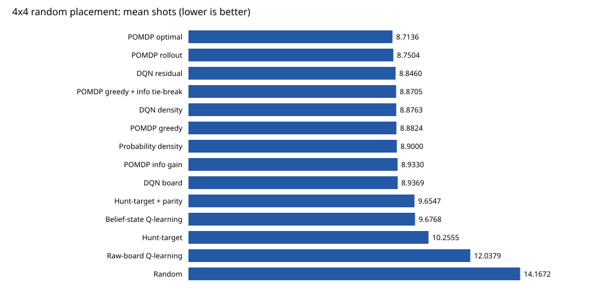
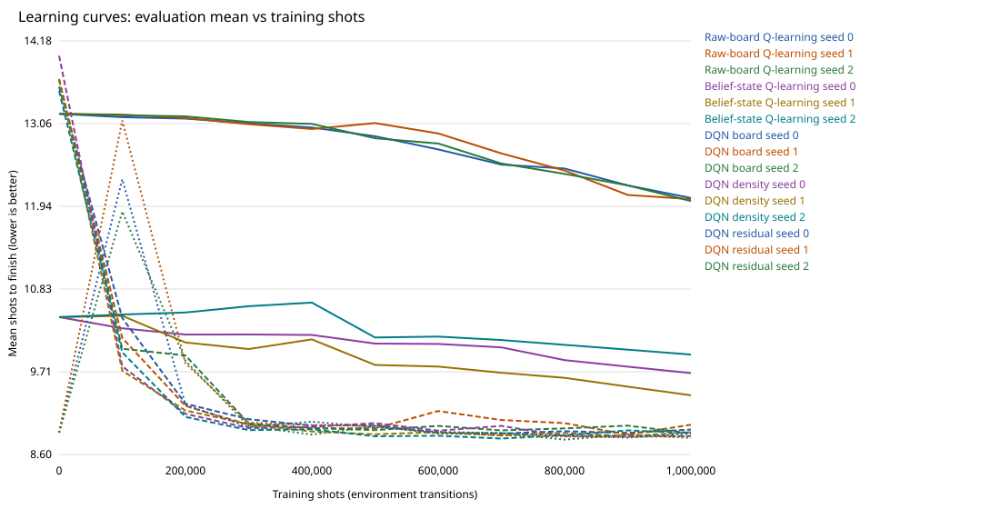

# 4x4 agent comparison

All 264 layouts × 20 policy seeds per model. Missing learning methods: none.

These are evaluation means with sampled random decisions; enumerating layouts does not integrate over every random tie. Training-seed spread and variation across games are reported separately. No held-out-layout generalization is measured.

Exact Bellman optimum: 8.746212 shots.

The sampled optimal-policy mean below this expectation is finite random-choice sampling variation, not a policy beating the exact optimum. Negative sampled gaps have the same interpretation.

Completed analysis: [comparison_results_README.md](../../docs/comparison_results_README.md).

| Agent | Training seeds | Mean shots | Gap to optimum | Game std | Seed std | Observed worst | Decision ms | Train seconds/seed |
|---|---|---|---|---|---|---|---|---|
| POMDP optimal | 0 | 8.7136 | -0.0326 | 1.6113 | N/A | 12 | 0.0988 | N/A |
| POMDP rollout | 0 | 8.7504 | +0.0042 | 1.6091 | N/A | 12 | 0.2289 | N/A |
| DQN residual | 3 | 8.8460 | +0.0997 | 1.6218 | 0.0250 | 13 | 1.5259 | 1181.57 |
| POMDP greedy + info tie-break | 0 | 8.8705 | +0.1242 | 1.6061 | N/A | 13 | 0.1068 | N/A |
| DQN density | 3 | 8.8763 | +0.1301 | 1.6445 | 0.0228 | 12 | 1.3339 | 1298.87 |
| POMDP greedy | 0 | 8.8824 | +0.1362 | 1.6128 | N/A | 13 | 0.2198 | N/A |
| Probability density | 0 | 8.9000 | +0.1538 | 1.6111 | N/A | 13 | 0.0600 | N/A |
| POMDP info gain | 0 | 8.9330 | +0.1867 | 1.7544 | N/A | 14 | 0.0978 | N/A |
| DQN board | 3 | 8.9369 | +0.1907 | 1.6579 | 0.0465 | 13 | 0.6907 | 741.50 |
| Hunt-target + parity | 0 | 9.6547 | +0.9085 | 2.0207 | N/A | 16 | 0.0164 | N/A |
| Belief-state Q-learning | 3 | 9.6768 | +0.9306 | 1.8887 | 0.2245 | 14 | 0.0530 | 13.37 |
| Hunt-target | 0 | 10.2555 | +1.5093 | 2.5777 | N/A | 16 | 0.0099 | N/A |
| Raw-board Q-learning | 3 | 12.0379 | +3.2917 | 2.4045 | 0.0172 | 16 | 0.0192 | 28.14 |
| Random | 0 | 14.1672 | +5.4210 | 1.8886 | N/A | 16 | 0.0070 | N/A |

## Placement habits

Each model's games are reweighted using the exact layout distribution for the habit. Random decisions still have finite sampling error. The oracle is told the habit; it does not learn it.

| Agent | Training seed | uniform | edges | center | horizontal | touching | 3 favorites |
|---|---|---|---|---|---|---|---|
| Random | None | 14.1672 | 14.2055 | 14.1240 | 14.2111 | 14.1530 | 14.2500 |
| Hunt-target | None | 10.2555 | 10.2694 | 10.1880 | 10.2815 | 9.9515 | 9.5167 |
| Hunt-target + parity | None | 9.6547 | 9.5989 | 9.7122 | 9.6743 | 9.3923 | 9.1333 |
| Probability density | None | 8.9000 | 9.4907 | 8.1242 | 8.9621 | 8.6132 | 8.4000 |
| POMDP greedy | None | 8.8824 | 9.5258 | 8.1039 | 8.9449 | 8.5869 | 8.3000 |
| POMDP rollout | None | 8.7504 | 9.3434 | 7.8268 | 8.8066 | 8.4018 | 8.3167 |
| POMDP optimal | None | 8.7136 | 9.2979 | 7.8386 | 8.7498 | 8.3375 | 8.2167 |
| POMDP info gain | None | 8.9330 | 9.6023 | 8.0717 | 8.9582 | 8.5326 | 8.4000 |
| POMDP greedy + info tie-break | None | 8.8705 | 9.4858 | 8.1034 | 8.9307 | 8.5686 | 8.3000 |
| Raw-board Q-learning | 0 | 12.0568 | 12.1284 | 11.8815 | 12.1862 | 11.7698 | 13.0000 |
| Raw-board Q-learning | 1 | 12.0417 | 11.9180 | 12.3227 | 12.2053 | 12.0201 | 13.6667 |
| Raw-board Q-learning | 2 | 12.0152 | 12.1854 | 11.8646 | 12.1649 | 11.7552 | 13.3333 |
| Belief-state Q-learning | 0 | 9.6932 | 9.9816 | 9.4065 | 9.9055 | 9.5323 | 10.0000 |
| Belief-state Q-learning | 1 | 9.3939 | 9.6667 | 9.4987 | 9.2163 | 9.2227 | 9.0000 |
| Belief-state Q-learning | 2 | 9.9432 | 10.0075 | 9.9564 | 9.8163 | 10.1870 | 10.3333 |
| DQN board | 0 | 8.9318 | 9.4641 | 8.5376 | 8.9818 | 8.5747 | 7.6667 |
| DQN board | 1 | 8.9962 | 9.3186 | 8.4381 | 9.1226 | 8.8049 | 9.3333 |
| DQN board | 2 | 8.8826 | 9.4820 | 8.1564 | 8.8836 | 8.4990 | 8.3333 |
| DQN density | 0 | 8.8447 | 9.4610 | 7.9564 | 8.8263 | 8.4635 | 8.6667 |
| DQN density | 1 | 8.8977 | 9.4571 | 8.4577 | 8.8628 | 8.6318 | 8.3333 |
| DQN density | 2 | 8.8864 | 9.3630 | 8.5543 | 8.9929 | 8.5808 | 7.3333 |
| DQN residual | 0 | 8.8788 | 9.5502 | 8.2555 | 8.9708 | 8.4927 | 9.0000 |
| DQN residual | 1 | 8.8409 | 9.4996 | 8.2137 | 8.8537 | 8.4627 | 9.0000 |
| DQN residual | 2 | 8.8182 | 9.3930 | 8.1049 | 8.8929 | 8.4091 | 8.3333 |
| POMDP greedy, told the habit (oracle) | None | 8.8824 | 8.3227 | 7.8017 | 8.3618 | 8.1241 | 5.6833 |

## Learning curves

## Head-to-head

80,400 games; first player won 55.90%. Equal training seed IDs are paired, and baselines are played against each trained seed. Each model pair alternates the first player. Overall macro gives equal weight to each opposing algorithm.

| Agent | Overall macro win rate |
|---|---|
| Random | 0.0607 |
| Hunt-target | 0.4192 |
| Hunt-target + parity | 0.4779 |
| Probability density | 0.5744 |
| POMDP greedy | 0.5700 |
| POMDP rollout | 0.6090 |
| POMDP optimal | 0.6157 |
| POMDP info gain | 0.5775 |
| POMDP greedy + info tie-break | 0.5876 |
| Raw-board Q-learning | 0.2228 |
| Belief-state Q-learning | 0.4911 |
| DQN board | 0.5905 |
| DQN density | 0.5980 |
| DQN residual | 0.6056 |

Full matrix: [tournament.csv](tournament.csv); counts: [tournament_pairs.csv](tournament_pairs.csv).

## Interpretation and limitations

- Compare learning methods at equal training shots, not equal replay updates or completed games. DQN reuses transitions; its gradient steps are recorded in the learning curves.
- Raw-board tables may have sparse coverage; belief-state Q-learning uses an exact model and excludes certain misses. DQN density/residual variants receive handcrafted probability-density features. These are different information/compute assumptions.
- Small differences between agents need more training seeds and policy samples before claiming a ranking. The standard deviations here are not confidence intervals, and the observed worst is not a proven worst case.
- Decision timing covers select_shot, including deferred belief updates, but excludes observe, reset and loading. The warm-up game is excluded and reported separately; global planner caches may already be warm. Training time excludes evaluation/checkpoint writing, but includes each implementation's training overhead.
- Models are loaded one at a time for solo evaluation and two at a time for head-to-head. Timing depends on the machine and memory pressure; checkpoint bytes are not resident memory.
- External checkpoints have unknown training budget/time unless supplied through the training manifest. Existing historical results are not substituted for any measurement.

Examples and full shot sequences: [cases.md](cases.md), [cases.json](cases.json). Raw paired games: [games.csv](games.csv). Source and checkpoint hashes: [manifest.json](manifest.json).
